 

I'm **Ash**. I build AI agents and the bots that live inside apps people already use: a WhatsApp bot that runs group chats, the same bot on Discord with music and an economy, voice agents that answer the phone in Hindi, and the storefronts and tournament sites around them.

Most of that runs in production, so it lives in private repos. The public ones are side quests.

 

### 現 &nbsp;On the bench

<table>
<tr><td align="center">零</td><td><b><a href="https://www.indratensei.me/qinshin">Zero</a></b></td><td>The WhatsApp bot that talks back. Send it a voice note, get one back. Plus the Jade economy, murder mysteries, MLBB scrims, stickers and downloads.</td></tr>
<tr><td align="center">結</td><td><b><a href="https://www.indratensei.me/qinshin/discord">Zero on Discord</a></b></td><td>Music, the Jade economy, and one profile shared with WhatsApp. Python, Postgres, Lavalink.</td></tr>
<tr><td align="center">声</td><td><b>JARVIS</b></td><td>Hands-free voice assistant. An Android app that drives my Windows machine through a bridge.</td></tr>
<tr><td align="center">話</td><td><b>Courier voice agent</b></td><td>Tells you where your parcel is, on a phone call, in Hindi, Marathi or English. Pipecat, Deepgram, Cartesia.</td></tr>
<tr><td align="center">罠</td><td><b>Interview Trap</b></td><td>System design interview reels in Hinglish, rendered as code with Remotion.</td></tr>
<tr><td align="center">灰</td><td><b><a href="https://www.indratensei.me">indratensei.me</a></b></td><td>My portfolio, plus Cubee, a little guide that roams the page and pulls about thirty faces.</td></tr>
</table>

### 戦 &nbsp;Shipped

- **Tournament ops AI** &nbsp;·&nbsp; a multi-agent pipeline that runs **50+ MLBB tournaments a month** in India. It replaced a three-person manual ops team.
- **Gaming top-up platform** &nbsp;·&nbsp; OTP login, wallets, orders and payment webhooks for **1,000+ users**. Fastify, MongoDB, Redis.
- **Storefront network** &nbsp;·&nbsp; three top-up stores on one shared core. **500+ active users** top up straight from WhatsApp.
- **Esports tournament platform** &nbsp;·&nbsp; registration, brackets and live scores for **100+ concurrent viewers** across 10+ tournaments.
- **WhatsApp ⇄ Discord AI bridge** &nbsp;·&nbsp; **2,000+ messages a day**, replies in under 5 seconds.

 

  

  

<code>$ ssh indratensei@github.com</code>

 

 

  

<picture>
  <source media="(prefers-color-scheme: light)" srcset="https://raw.githubusercontent.com/IndraTensei/indratensei/output/snake.svg">
  
</picture>

転生 <i>tensei</i>, reincarnation &nbsp;·&nbsp; 灰 <i>hai</i>, ash &nbsp;·&nbsp; that's the whole name
 

